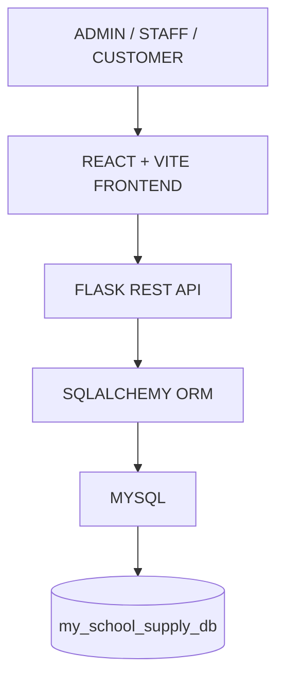

# Technology Stack and System Architecture

The School Supply Inventory and Sales Management System uses a client-server architecture. A responsive React interface communicates with a Flask REST API, which applies the business rules and uses SQLAlchemy to persist data in MySQL.

## Technology Stack

### Frontend

| Technology | Purpose |
| --- | --- |
| React.js | Builds the interactive user interface from reusable components. |
| Vite | Provides the frontend development server and production build tool. |
| HTML5 | Defines the semantic structure of each page. |
| CSS3 | Provides layout, styling, responsive behavior, and visual states. |
| JavaScript | Implements client-side interaction, state, and API communication. |
| Responsive UI | Allows the system to work across desktop, tablet, and mobile screen sizes. |
| React Components | Encapsulate reusable interface elements and role-specific screens. |
| React Router | Provides page navigation and route-based rendering for the frontend. |

The frontend is responsible for the user interface and interaction for all three system roles:

- **Admin:** manages users, categories, products, inventory, and system activity.
- **Staff:** manages operational inventory, products, orders, and sales workflows.
- **Customer:** browses products, manages an account, and places orders.

### Backend

| Technology | Purpose |
| --- | --- |
| Python | Provides the backend programming language and application logic. |
| Flask Framework | Creates the web application and organizes HTTP routes. |
| Flask REST API | Exposes API endpoints that receive requests and return JSON responses. |
| SQLAlchemy ORM | Maps Python models to database tables and manages database queries. |
| Python-dotenv | Loads database credentials and other configuration from environment variables. |

The backend handles authentication and authorization, user management, product management, inventory management, categories, orders, sales and transactions, business rules, and API requests and responses.

### Database

| Technology | Purpose |
| --- | --- |
| MySQL | Relational database that stores and manages application data. |
| XAMPP | Local development environment used to run the MySQL database service. |
| phpMyAdmin | Browser-based tool for inspecting and administering the MySQL database. |

**Database name:** `my_school_supply_db`

MySQL stores and manages the system's user, product, inventory, order, and sales data. The major application tables are:

| Table | Stored information |
| --- | --- |
| `users` | Accounts, roles, credentials, and account status. |
| `categories` | Product categories and descriptions. |
| `products` | Product details, prices, and current stock values. |
| `inventory` | Quantities, reorder levels, and storage locations. |
| `orders` | Customer order headers, totals, and statuses. |
| `order_items` | Products and quantities belonging to each order. |
| `sales` | Completed sales, totals, payment methods, and statuses. |
| `sale_items` | Products and quantities belonging to each sale. |

The implementation also includes `user_sessions` and `activity_logs` as supporting tables for session monitoring and audit history.

## Database Connection Flow

```text
React + Vite Frontend
          |
          v
Flask REST API
          |
          v
SQLAlchemy ORM
          |
          v
MySQL Database
          |
          v
my_school_supply_db
```

The frontend communicates with the Flask backend through API endpoints. The Flask backend validates each request, applies the business logic, and communicates with MySQL through SQLAlchemy. The database returns the requested data through the same path in reverse.

## Authentication and Security

The system's authentication and security controls include:

- Login and customer registration.
- Role-based access control for **Admin**, **Staff**, and **Customer** roles.
- Password hashing before credentials are stored.
- Protected API routes that require an authenticated user and, where needed, a specific role.
- Session-based authentication for maintaining a signed-in user session. Token-based authentication can be used for a future stateless API deployment.
- Environment variables for database credentials and the Flask secret key, loaded with `python-dotenv`.
- HTTP-only and same-site session cookie settings for the browser session.
- Request validation for account data, passwords, and uploaded product images.

## System Architecture Diagram



### Layer Responsibilities

1. **Users:** Admin, Staff, and Customer users access features according to their roles.
2. **React + Vite frontend:** Displays responsive pages and components, collects user input, and sends API requests.
3. **Flask REST API:** Receives requests, authenticates users, checks permissions, executes business logic, and returns responses.
4. **SQLAlchemy ORM:** Translates backend operations into structured database queries and maps database rows to Python models.
5. **MySQL:** Provides relational storage and manages data consistency between related records.
6. **`my_school_supply_db`:** Contains the system's application tables and operational records.

## Technology Classification

| Section | Technologies |
| --- | --- |
| **Frontend** | React.js, Vite, HTML5, CSS3, JavaScript, responsive UI, React Components, React Router |
| **Backend** | Python, Flask Framework, Flask REST API |
| **Database** | MySQL, XAMPP, phpMyAdmin, `my_school_supply_db` |
| **Frameworks** | React.js, Vite, Flask Framework |
| **Libraries** | SQLAlchemy ORM, Python-dotenv, React Components, React Router |
| **Development Tools** | Visual Studio Code, XAMPP, phpMyAdmin, Git/GitHub, web browser, Postman or another API testing tool |
| **Security** | Password hashing, role-based access control, protected API routes, session-based authentication, environment variables |

## Development Tools

- **Visual Studio Code:** edits and runs the frontend and backend source code.
- **XAMPP:** runs the local MySQL service.
- **phpMyAdmin:** manages and reviews the local database.
- **Git/GitHub:** tracks source-code changes and supports collaboration.
- **Web browser:** runs and tests the responsive frontend.
- **Postman or another API testing tool:** tests Flask REST API endpoints independently of the frontend.

## Implementation Note

The current frontend source uses hash-based navigation in `App.jsx`. React Router is the designated route-management technology for the documented architecture; when it is enabled in the implementation, it should replace the manual hash route handling rather than be used alongside it.